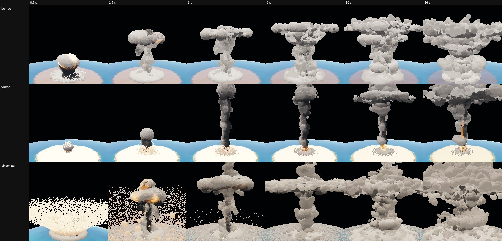

# planet-3d-labor

**Deutsch** · [English](#english)

Forschungslabor: Wie werden aus „gemalten" 2D-Planeten (Gasriese, Gestein, Mond) echte 3D-Körper, die in Echtzeit auf Einschlag, Atombombe, Mondkollision und Vulkanausbruch reagieren? WebGPU, läuft im Browser.

> **Ehrlicher Stand:** Das Ziel ist **nicht erreicht**. Die Labore sind belegte Versuche und messbare Bausteine, kein fertiges Produkt. `ZIEL.md` hält fest, was gewollt ist, welche Wege es gibt und woran bisherige Versuche gescheitert sind.

## Inhalt

| Ordner / Datei | Was es ist |
|---|---|
| `ZIEL.md` | Ziel, Messkriterien, Auftrag Bild für Bild, alle bekannten Wege, bisherige Versuche |
| `ereignis-labor/` | Vulkan, Atombombe, Einschlag: dünner 2D-Träger je Ereignis plus 3D-Marker-Partikel auf dem Planeten. Mit Zeitraster-, Physik- und Kostenprüfung. Eine Datei pro Baustein. |
| `wasserkugel-labor/` | Gitter-Strömung (Tasse mit Milch/Tee, Wasserkugel) und MLS-MPM-Teilchenplaneten mit Einschlag, sechs Darstellungsverfahren. |



*Zeilen = Ereignis (Bombe, Vulkan, Einschlag), Spalten = Zeitpunkt (0,5 s bis 16 s). Software-Renderer, Zeiten sind keine Handy-Zeiten.*

## Starten

Die Seiten brauchen WebGPU (aktuelles Chrome/Edge, Android-Chrome 121+, Safari 26+).

```bash
cd ereignis-labor
npm install
npm run bauen        # dist/ereignis.html, eine einzelne Datei
```

`wasserkugel-labor/euler.html` und `wasserkugel-labor/index.html` lassen sich direkt im Browser öffnen; fertige Einzeldateien liegen in `dist/`.

## Nicht enthalten

Referenz- und Messbilder aus fremden Quellen (`ziel-bilder/`, `wasserkugel-labor/ref/`) sind wegen ungeklärter Lizenz nicht im Repo. Tests, die `ref/` brauchen, laufen deshalb nicht ohne eigene Referenzfotos. Herkunft der Techniken: [NOTICE.md](NOTICE.md).

## Lizenz

MIT – siehe [LICENSE](LICENSE).

---

## English

Research lab: how do you turn "painted" 2D planets (gas giant, rocky planet, moon) into real 3D bodies that react in real time to impacts, nukes, moon collisions and volcanic eruptions? WebGPU, runs in the browser.

> **Honest status:** the goal is **not reached**. The labs are documented experiments and measurable building blocks, not a finished product. `ZIEL.md` (German) records what is wanted, which approaches exist and why earlier attempts failed.

### Contents

| Folder / file | What it is |
|---|---|
| `ZIEL.md` | Goal, acceptance criteria, task list, all known approaches, past attempts (German) |
| `ereignis-labor/` | Volcano, nuke, impact: a thin 2D carrier per event plus 3D marker particles on the planet. Time-grid, physics and cost tests. One file per building block. |
| `wasserkugel-labor/` | Grid fluid (cup with milk/tea, water ball) and MLS-MPM particle planets with impacts, six rendering methods. |

The image above shows rows = event (bomb, volcano, impact) and columns = time (0.5 s to 16 s), rendered with a software renderer.

### Run

Needs WebGPU (current Chrome/Edge, Android Chrome 121+, Safari 26+).

```bash
cd ereignis-labor
npm install
npm run bauen        # dist/ereignis.html, a single file
```

`wasserkugel-labor/euler.html` and `index.html` open directly in the browser; ready-made single files are in `dist/`.

### Not included

Reference and measurement images from third-party sources (`ziel-bilder/`, `wasserkugel-labor/ref/`) are left out because their licence is unclear. Tests that need `ref/` will not run without your own reference photos. Technique credits: [NOTICE.md](NOTICE.md).

### License

MIT – see [LICENSE](LICENSE).
